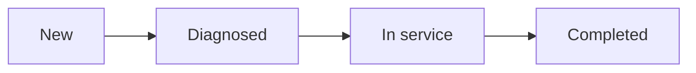
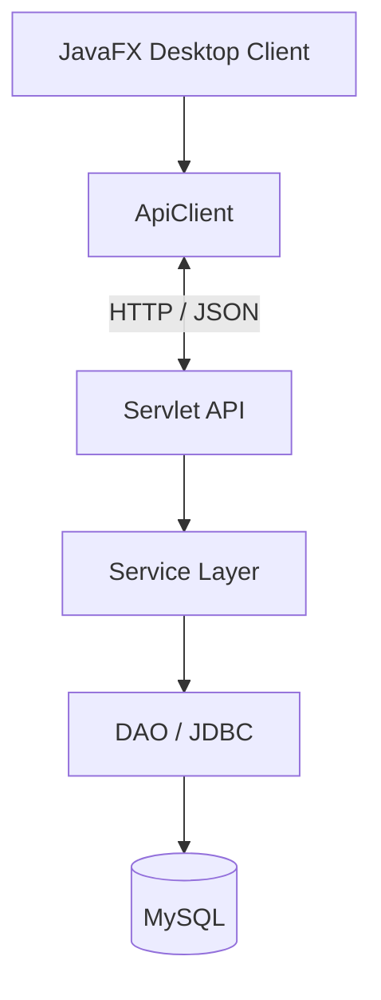
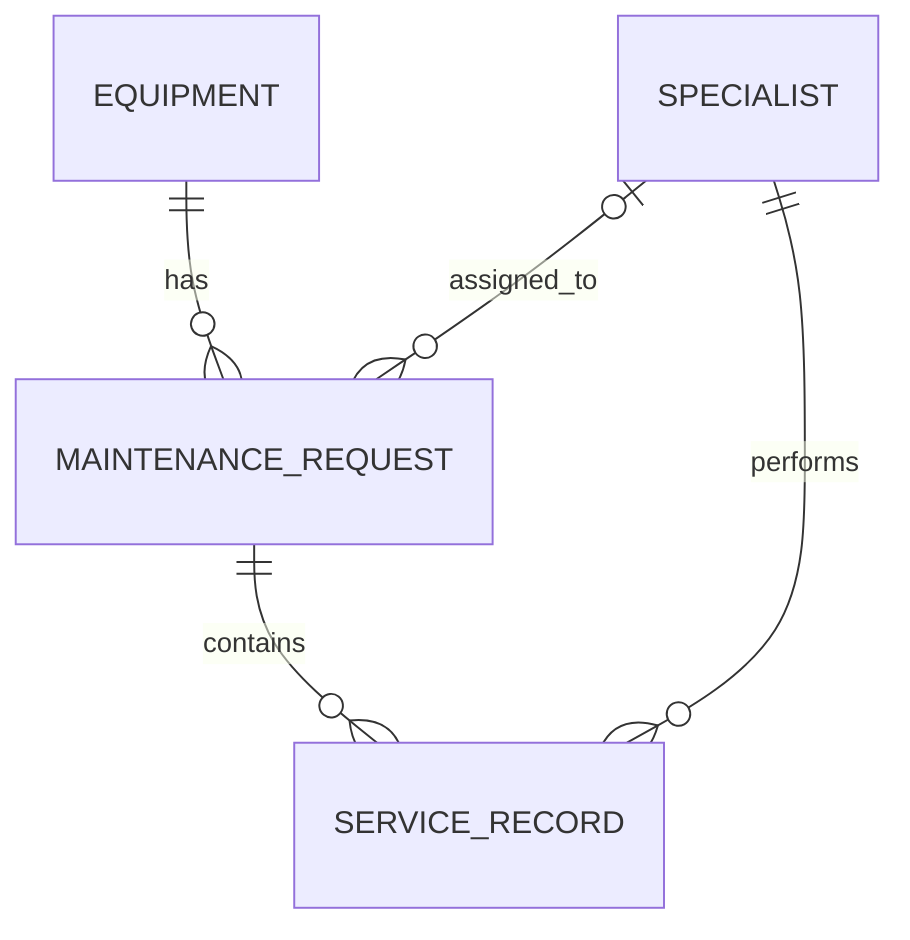

<div align="center">
  
  <h1>SERVETRA</h1>
  <h3>Laboratory Equipment &amp; Maintenance Management</h3>
  <p><em>Keep science moving. Make every instrument count.</em></p>
  <p>A self-hosted, cross-platform maintenance management system built to help laboratories, research facilities, educational institutions and community science initiatives keep essential equipment operational.</p>
  <p>
    
    
    
    
    
    
    
  </p>
  <p><a href="#getting-started">Getting started</a> · <a href="#features">Features</a> · <a href="#architecture">Architecture</a> · <a href="#verification--tests">Tests</a> · <a href="https://github.com/S1nflex/Servetra/issues">Issues</a></p>
</div>

---

## About this project

Scientific progress depends on reliable infrastructure. A single unavailable centrifuge, microscope or analytical workstation can interrupt experiments, delay teaching and limit access to shared research resources.

**SERVETRA** brings equipment inventory, maintenance requests, specialist coordination and service history together in one desktop application. It turns scattered spreadsheets and informal repair requests into structured, actionable maintenance workflows, backed by a centralized database and a transparent prioritization model.

The mission is to make dependable laboratory operations more accessible, especially for institutions and community initiatives that need practical software they can host and maintain themselves. SERVETRA is built with open collaboration, portability and understandable engineering in mind.

## Contents

- [Use Cases & Target Users](#use-cases--target-users)
- [Problem Statement](#problem-statement)
- [Features](#features)
- [Maintenance Priority Engine](#maintenance-priority-engine)
- [Work Order Lifecycle](#work-order-lifecycle)
- [Architecture](#architecture)
- [Technology Stack](#technology-stack)
- [Project Structure](#project-structure)
- [Getting Started](#getting-started)
- [Configuration](#configuration)
- [CSV Import](#csv-import)
- [API Endpoints](#api-endpoints)
- [Verification & Tests](#verification--tests)
- [Development Principles](#development-principles)
- [Roadmap](#roadmap)
- [Contributing](#contributing)
- [Author](#author)
- [License](#license)

---

## Use Cases & Target Users

| Environment | How SERVETRA can help |
|:---|:---|
| University and teaching laboratories | Maintain equipment inventories, coordinate repairs and reduce disruption to practical classes. |
| Research facilities | Prioritize failures affecting experiments and preserve maintenance history for shared instruments. |
| Community laboratories and makerspaces | Organize shared assets and track maintenance without relying on disconnected spreadsheets. |
| Technical service teams | Assign specialists, follow work orders through their lifecycle and record time, costs and completed work. |
| Institutional IT and laboratory infrastructure teams | Track computers, network equipment and other supporting assets alongside scientific instruments. |

## Problem Statement

Laboratories often manage maintenance information across disconnected files, emails and paper records. This makes it difficult to answer three operational questions:

- **What equipment needs attention right now?**
- **Which failure should be addressed first, and why?**
- **Who is responsible for the work, and what has already been done?**

SERVETRA addresses these questions through a central equipment registry, structured work orders, a deterministic priority score and linked service records. Its goal is to support better maintenance decisions, not to replace qualified technical judgment or laboratory safety procedures.

---

## Features

| Module | Capabilities |
|:---|:---|
| **Operations Dashboard** | Live counts from the backend for registered equipment, open work orders, critical open work orders and completed work orders. |
| **Equipment Registry** | Create, read, update and delete equipment records; track inventory numbers, manufacturer, model, serial number, location, department, criticality and next service date; search the registry. |
| **Work Order Management** | Register faults, assign specialists, record diagnostic notes and deadlines, filter by status and visualize priority with color-coded rows. |
| **Specialist Directory** | Maintain contact details, specialization and active status for maintenance personnel. |
| **Service History** | Link service records to work orders and specialists; store work descriptions, dates, duration and costs. |
| **Priority Engine** | Server-side weighted scoring with validated inputs, deterministic decimal arithmetic and four priority levels. |
| **Background CSV Import** | Import equipment through JavaFX `Task` with progress, validation and separate counters for successful records, duplicates, invalid rows and server errors. |
| **Accessible Desktop Interface** | English and Ukrainian localization, light and dark themes, JavaFX forms, tables and error dialogs. |
| **HTTP/JSON API** | Versioned endpoints, centralized validation, structured error responses and a database health check. |

## Maintenance Priority Engine

SERVETRA uses an explainable, deterministic model rather than an opaque ranking algorithm.

```text
I = 0.40 × F1 + 0.35 × F2 + 0.25 × F3
```

| Factor | Meaning | Weight |
|:---|:---|---:|
| F1 | Equipment criticality | 40% |
| F2 | Failure severity | 35% |
| F3 | Operational impact of downtime | 25% |

Each factor is an integer from 0 to 100. The server derives F1 from the equipment record and calculates the final index using `BigDecimal`, rounded to two decimal places. Users provide the failure severity and downtime impact, not the calculated score.

| Index | Priority |
|:---|:---|
| 0 ≤ I < 25 | Low |
| 25 ≤ I < 50 | Medium |
| 50 ≤ I < 75 | High |
| 75 ≤ I ≤ 100 | Critical |

For example, an instrument with criticality 90, failure severity 80 and downtime impact 60 receives a priority score of **79.00 (Critical)**.

The score supports operational triage. It is not a certified safety or risk assessment.

## Work Order Lifecycle



New work orders start in `NEW`. The service layer enforces valid transitions and rejects skipped, backward or repeated states. An invalid transition produces an HTTP `409 Conflict` response rather than silently modifying the work order.

---

## Architecture

SERVETRA separates the desktop interface, network transport, domain logic and database access.



| Layer | Responsibility |
|:---|:---|
| JavaFX | User interaction, forms, tables, localization and visual feedback. |
| ApiClient | HTTP requests, JSON serialization and response handling. |
| Servlet | API routing, HTTP status codes and JSON responses. |
| Service | Validation, work order lifecycle, priority calculation and domain operations. |
| DAO/JDBC | Parameterized SQL, persistence and mapping database records to Java objects. |
| MySQL | Relational storage, keys, constraints and referential integrity. |

The desktop client never connects directly to MySQL. Both components can be built and tested independently using Maven.

### Data model



The four entities form a connected maintenance model: an asset can have multiple work orders, a specialist may be assigned to a request, and service records preserve the details of work performed.

## Technology Stack

| Category | Technology |
|:---|:---|
| Language | Java 21 |
| Desktop UI | JavaFX 21.0.2, CSS, ResourceBundle |
| Server | Servlet API 4.0.1 (`javax.servlet`), Apache Tomcat 9 |
| Transport | HTTP / JSON, Java HTTP client |
| Serialization | Jackson 2.18.2, Java Time module |
| Database | MySQL, JDBC, Connector/J 9.1.0 |
| Build | Apache Maven |
| Testing | JUnit 5.11.4, Maven Surefire, optional Failsafe integration profile |
| Logging | `java.util.logging` |

## Project Structure

```text
SERVETRA/
├── client/
│   ├── pom.xml
│   ├── sample-data/equipment.csv
│   └── src/
│       ├── main/java/          # JavaFX, HTTP client, CSV import, models
│       ├── main/resources/     # Logo, styles and translations
│       └── test/java/          # Client unit tests
├── server/
│   ├── pom.xml
│   └── src/
│       ├── main/java/          # Servlets, services, DAOs, domain models
│       ├── main/webapp/        # Servlet routing configuration
│       └── test/java/          # Unit and optional integration tests
├── docs/API.md                 # API contract and payload examples
├── tools/                      # Local environment and smoke-test utilities
├── database.sql                # Schema and demonstration records
├── .env.example                # Configuration reference
├── .gitignore
├── logo.png
└── README.md
```

---

## Getting Started

### 1. Prerequisites

- [JDK 21](https://adoptium.net/) (including `javac`)
- [Apache Maven](https://maven.apache.org/download.cgi)
- [MySQL](https://dev.mysql.com/downloads/) (8.x recommended; local demonstration also verified against 9.2)
- [Apache Tomcat 9](https://tomcat.apache.org/download-90.cgi) (use 9.x, not 10/11, because the application uses `javax.servlet`)

Maven resolves JavaFX dependencies automatically. No separate JavaFX SDK or IDE is required.

### 2. Clone the repository

```bash
git clone https://github.com/S1nflex/Servetra.git
cd Servetra
```

### 3. Initialize MySQL

Start MySQL and import [database.sql](database.sql) into a dedicated development instance or database server.

> **Warning:** `database.sql` drops and recreates the `servetra` schema. Run it only against the intended server, after backing up any existing SERVETRA data. Do not use it as a migration script on a live installation.

From the repository root in Bash or Windows CMD (adjust port if needed):

```bash
mysql -h 127.0.0.1 -P 3306 -u root -p < database.sql
```

Windows PowerShell users can open the SQL file in MySQL Workbench or use `cmd /c "mysql -h 127.0.0.1 -P 3306 -u root -p < database.sql"` if `mysql` is on PATH.

Create a dedicated application account in MySQL, replacing the example password with a private value:

```sql
CREATE USER IF NOT EXISTS 'servetra'@'localhost'
    IDENTIFIED BY 'replace-with-your-local-password';
GRANT SELECT, INSERT, UPDATE, DELETE ON servetra.*
    TO 'servetra'@'localhost';
```

Use the actual password of this account if it already exists. The application does not need the MySQL root account.

### 4. Build and deploy the backend

From the repository root:

```bash
mvn -f server/pom.xml clean package
```

The build produces `server/target/servetra-server.war` and runs the server unit tests.

**Windows PowerShell** (set the path to your extracted Tomcat 9 folder):

```powershell
$env:CATALINA_HOME = 'C:\Tools\apache-tomcat-9'
$env:CATALINA_BASE = $env:CATALINA_HOME
$env:SERVETRA_DB_URL = 'jdbc:mysql://127.0.0.1:3306/servetra'
$env:SERVETRA_DB_USER = 'servetra'
$env:SERVETRA_DB_PASSWORD = Read-Host 'MySQL application password'

Copy-Item server/target/servetra-server.war "$env:CATALINA_HOME/webapps/" -Force
& "$env:CATALINA_HOME/bin/catalina.bat" run
```

**Linux / macOS** (Bash; set your Tomcat folder):

```bash
export CATALINA_HOME=/path/to/apache-tomcat-9
export CATALINA_BASE="$CATALINA_HOME"
export SERVETRA_DB_URL='jdbc:mysql://127.0.0.1:3306/servetra'
export SERVETRA_DB_USER=servetra
read -rs -p 'MySQL application password: ' SERVETRA_DB_PASSWORD
printf '\n'
export SERVETRA_DB_PASSWORD

cp server/target/servetra-server.war "$CATALINA_HOME/webapps/"
"$CATALINA_HOME/bin/catalina.sh" run
```

Use port `3308` in the JDBC URL if your dedicated MySQL instance listens on that port. Keep MySQL and Tomcat running while using the desktop client.

### 5. Check backend health

Open [http://localhost:8080/servetra-server/api/v1/health](http://localhost:8080/servetra-server/api/v1/health) or run:

```bash
curl http://localhost:8080/servetra-server/api/v1/health
```

A successful response has HTTP status 200:

```json
{"database":"UP","status":"UP"}
```

### 6. Launch the desktop application

Open a new terminal at the repository root:

```bash
mvn -f client/pom.xml javafx:run
```

The desktop application opens with the Overview, Equipment, Work Orders, Specialists and Service Records tabs. To use another backend address, set `SERVETRA_API_BASE` before launching.

## Configuration

See [.env.example](.env.example) for the available variables. Set them in the environment of the process that starts the backend or client; the example file is a reference and is not automatically loaded by Java.

| Variable | Component | Default / example |
|:---|:---|:---|
| `SERVETRA_DB_URL` | Server | `jdbc:mysql://localhost:3306/servetra` |
| `SERVETRA_DB_USER` | Server | `servetra` |
| `SERVETRA_DB_PASSWORD` | Server | Set your own password; do not commit it. |
| `SERVETRA_API_BASE` | Client | `http://localhost:8080/servetra-server/api/v1` |

> **Deployment boundary:** The current release is intended for local development and trusted environments. The API does not implement authentication or role-based access control. Do not expose it directly to the public internet or use it for sensitive production data without additional security controls, backups and operational review.

---

## CSV Import

Use the Equipment tab and select **Import CSV** to add multiple assets without freezing the UI. The importer reads UTF-8 text, uses a semicolon delimiter and expects the following header:

```text
inventory_number;name;category;manufacturer;model;serial_number;location;department;criticality_score;next_service_due
```

Example:

```csv
LAB-NEW-001;Digital microscope;LAB;Leica;DM750;MIC-001;Lab 112;Biology;75;2027-01-20
```

- `inventory_number`, `name`, `category` and `location` are required.
- `criticality_score` must be an integer between 0 and 100.
- `next_service_due` uses `YYYY-MM-DD` or may be empty.
- Duplicate inventory numbers and invalid records are reported separately; a bad row does not prevent other valid rows from being processed.

The sample registry is located at `client/sample-data/equipment.csv`. In a local demonstration, all 50 additional equipment records were imported successfully, increasing the initial registry from 3 to 53 assets.

## API Endpoints

Base URL: `http://localhost:8080/servetra-server/api/v1`

| Method | Route | Purpose |
|:---|:---|:---|
| GET | `/health` | Backend and database health |
| GET / POST | `/equipment` | List or create equipment; GET supports `q` |
| GET / PUT / DELETE | `/equipment/{id}` | Read, update or delete equipment |
| GET / POST | `/specialists` | List or create specialists |
| GET / PUT / DELETE | `/specialists/{id}` | Manage a specialist |
| GET / POST | `/requests` | List or create work orders; GET supports `status` |
| GET / PUT / DELETE | `/requests/{id}` | Manage a work order |
| POST | `/requests/{id}/transitions` | Change work order status |
| GET / POST | `/service-records` | List or create service records; GET supports `requestId` |
| GET / PUT / DELETE | `/service-records/{id}` | Manage a service record |

Example transition request body:

```json
{"toStatus":"DIAGNOSED"}
```

Structured error example:

```json
{
  "error": {
    "code": "INVALID_TRANSITION",
    "message": "Transition NEW -> COMPLETED is not allowed"
  }
}
```

See [API documentation](docs/API.md) for representative payloads and the complete status-code policy.

---

## Verification & Tests

The latest recorded local unit-test run completed successfully for both Maven modules:

| Test suite | Tests | Failures | Errors | Skipped |
|:---|---:|---:|---:|---:|
| PriorityCalculatorTest | 8 | 0 | 0 | 0 |
| LifecycleTest | 8 | 0 | 0 | 0 |
| ValidationTest | 6 | 0 | 0 | 0 |
| EquipmentCsvMapperTest | 10 | 0 | 0 | 0 |
| FormParsersTest | 7 | 0 | 0 | 0 |
| LocalizationTest | 1 | 0 | 0 | 0 |
| **Total** | **40** | **0** | **0** | **0** |

Both modules reported `BUILD SUCCESS` on November 25, 2026. The unit tests do not require a running MySQL or Tomcat instance. Run them from the repository root:

```bash
mvn -f server/pom.xml clean test
mvn -f client/pom.xml clean test
```

The project also includes an optional real-MySQL DAO integration test and a Windows API smoke-test utility. Run these only against a disposable development database with the appropriate connection variables set:

```powershell
$env:SERVETRA_RUN_INTEGRATION = 'true'
mvn -f server/pom.xml -Pintegration verify

# With the backend already running:
.\tools\windows\smoke-api.ps1
```

These optional checks are not included in the 40 confirmed unit-test results.

## Development Principles

| Principle | Implementation |
|:---|:---|
| **Infrastructure for science** | Centralized maintenance records designed to support continuity of research and education. |
| **Explainable decisions** | Explicit weights and deterministic arithmetic instead of opaque prioritization. |
| **Separation of concerns** | Dedicated UI, transport, service and persistence boundaries. |
| **Data integrity** | Relational constraints, prepared statements, server-side validation and controlled lifecycle transitions. |
| **Responsive interaction** | Background CSV processing and progress feedback in JavaFX. |
| **Portability** | Maven-managed dependencies and environment-based configuration. |
| **Community accessibility** | English and Ukrainian UI, light and dark themes, and self-hosted operation. |

## Roadmap

Potential future improvements, not part of the current implementation:

- Authentication and role-based permissions for shared deployments.
- Preventive maintenance reminders and recurring service schedules.
- QR-code and barcode support for equipment identification.
- Maintenance analytics and downtime reporting.
- Containerized deployment and automated CI verification.
- Additional translations and accessibility improvements.

## Contributing

Feedback from laboratory personnel, researchers, technical specialists and developers is welcome. Use [GitHub Issues](https://github.com/S1nflex/Servetra/issues) to report reproducible bugs or suggest improvements. Include relevant logs, expected behavior and environment details, but never share credentials or real sensitive laboratory records.

For code contributions, keep changes focused, follow the existing layered architecture and run the appropriate unit tests. A formal contribution license must be established before accepting contributions for open-source distribution.

## Author

**S1nflex** · [GitHub](https://github.com/S1nflex)

## License & Attribution

SERVETRA is released under the MIT License.

The software is free to use, modify and distribute for personal, academic, research and commercial purposes, subject to the terms of the MIT License.

All distributed copies or substantial portions of the software must retain the original copyright and license notices.

When using SERVETRA in derivative projects, publications or research, please credit the original author and reference the official repository.

Original Author: S1nflex

Official Repository: github.com/S1nflex/Servetra

Copyright © 2026 S1nflex.

---

<div align="center">
  <strong>SERVETRA</strong><br />
  <em>Reliable equipment. Continuity of research. Science that keeps moving.</em>
</div>
